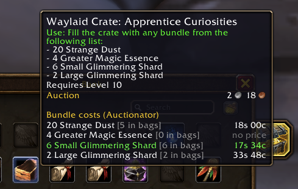
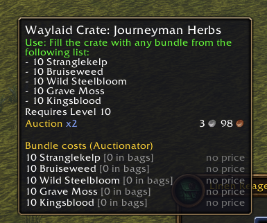

# Waylaid Crates Made Easy

A World of Warcraft Forever addon that shows which bundle is cheapest to fill a Waylaid Crate with.

Hover any Waylaid Crate and a block is added to its tooltip. Each bundle the crate accepts gets its own line, showing how many of that item you have in your bags and what the whole bundle costs at the auction house, using [Auctionator](https://www.curseforge.com/wow/addons/auctionator) prices. The cheapest bundle is shown in green.



## Features

- **Works on every Waylaid Crate.** It reads the bundle list straight from the crate's tooltip, so new crates work without an update.
- **Total cost per bundle:** quantity × Auctionator's latest price.
- **Cost to buy what you're missing:** if you already have some of the item, the line also shows what the rest would cost, for example `1g 20s (81s to buy)`, or `(have all)` when your bags cover the whole bundle.
- **Cheapest bundle in green:** the bundle that costs the least to buy, counting what's in your bags. Bundles without a price are never marked cheapest.
- **Bag count:** how many of each item you already have in your bags (bank not included).
- **"no price"** appears when Auctionator has no scan data for the item, or the game hasn't loaded that item yet. The addon learns item names from Auctionator scans (including the summary-mode full scan), your bags and item tooltips you see, and remembers them between sessions. After a full scan, give it a few seconds to look up names before hovering a crate.
- **Without Auctionator** you still get the bag counts.



## Installation

1. **[Download WaylaidCratesMadeEasy.zip](https://github.com/lucasreppewelander/waylaid-crate-made-easy/releases/latest/download/WaylaidCratesMadeEasy.zip)**
2. Extract it into `World of Warcraft/_forever_/Interface/AddOns/`. You should end up with `AddOns/WaylaidCratesMadeEasy/WaylaidCratesMadeEasy.toc`.
3. Restart the game or type `/reload`.

Don't use GitHub's green **Code → Download ZIP** button. It names the folder `waylaid-crate-made-easy-main`, and WoW won't load the addon from a folder with that name.

For prices, install [Auctionator](https://www.curseforge.com/wow/addons/auctionator) and run a scan at the auction house.

If the addon shows as out of date, tick **Load out of date AddOns** on the character select screen. You can also update the `## Interface:` line in `WaylaidCratesMadeEasy.toc` to your client's version. Run `/dump select(4, GetBuildInfo())` in game to find it.

## Limitations

- English game client only. The addon finds the bundle list by the text "Fill the crate with any bundle from the following list:".

## Development

The tooltip parser has tests that run outside the game:

```sh
luajit tests/parse_test.lua
```
